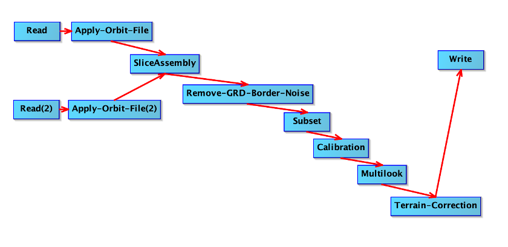
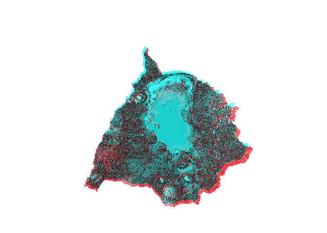
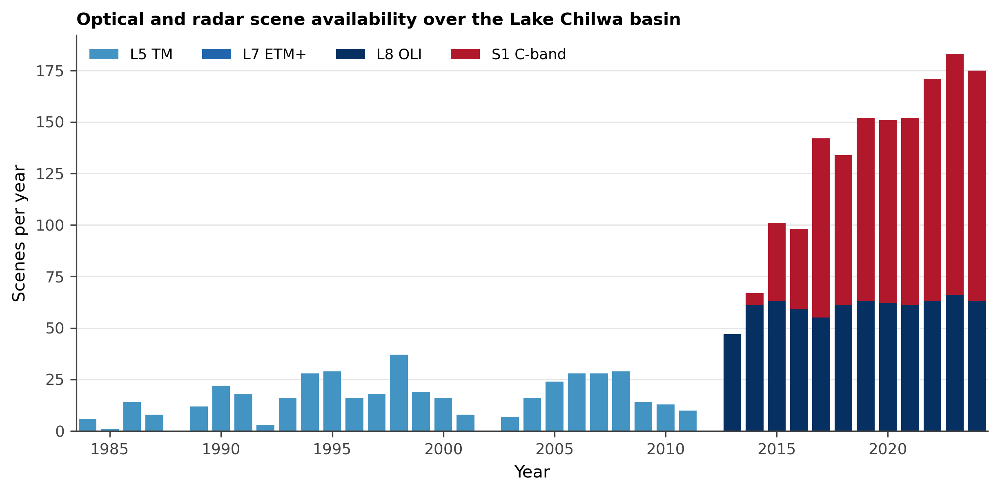
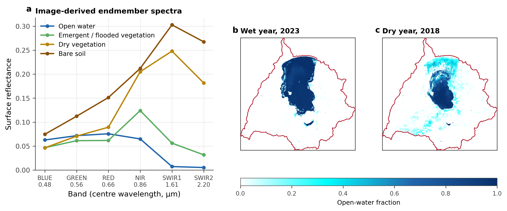
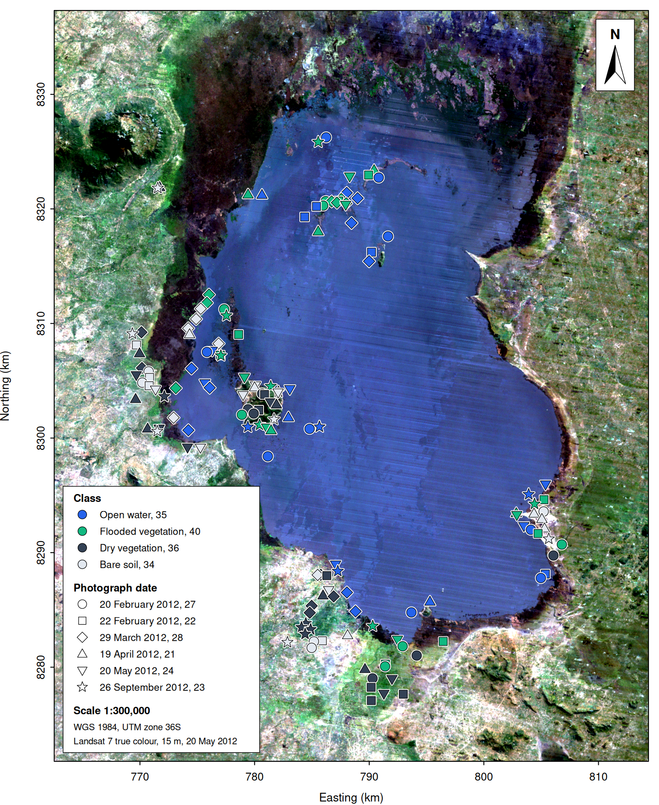
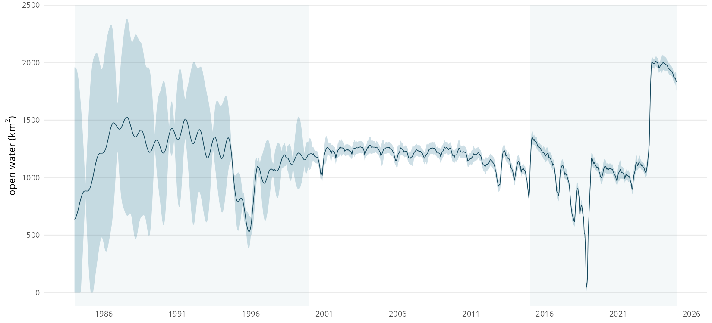
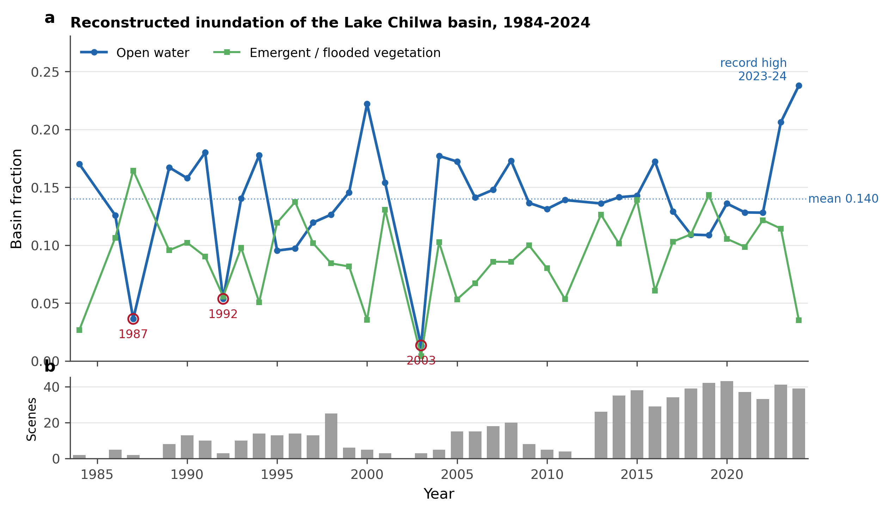
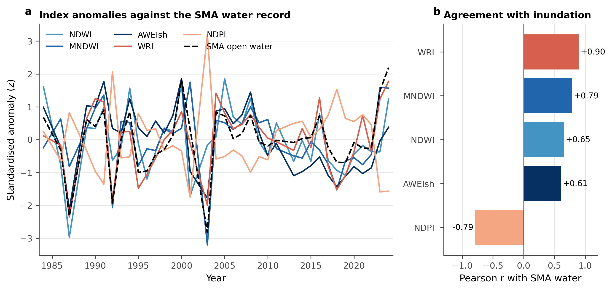
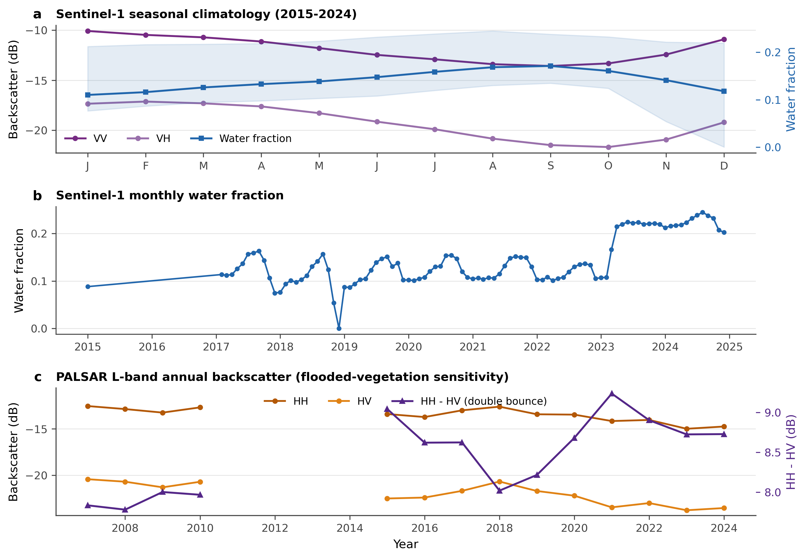
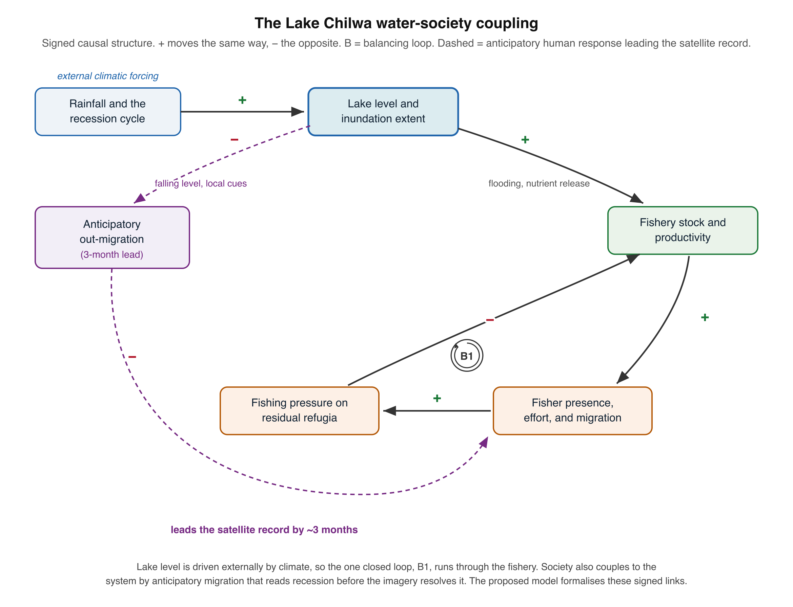

# Mapping the wetland inundation dynamics of Lake Chilwa’s recession and refilling cycles using multisource remote sensing data

*Integrating optical-radar time-series data with participatory mapping of migrant fishing communities*

## Abstract

Surface water and open water are treated as synonyms across the wetland literature, so every surface water record reports only the fraction of water lying open to the sky, and where a reed belt holds much of the standing water that is a measurement of the wrong quantity. Few studies measure the vegetated fraction directly, because no optical sensor resolves water beneath a stand and the reference labels cannot be collected from above. This study built a sixteen-day record of inundated area for the Lake Chilwa basin, a shallow endorheic lake in southern Malawi that recedes and refills across roughly fifteen years, spanning forty-one years from 1984 to 2024 (936 steps, 8,752 km2, 562 of them carrying a direct observation). Water area measured by Landsat and by the Moderate Resolution Imaging Spectroradiometer was combined in a state-space model, a statistical model that updated its estimate of the lake at each sixteen-day step as observations arrived and gave the uncertainty of every estimate. The design followed a published pixel-by-pixel method for combining the two satellites but was applied to the water area of the whole basin, and it filled the seventeen months from October 2011 to March 2013 when the only Landsat satellite over the basin, Landsat 7, recorded images with strips of missing data. Water standing within vegetation was measured from the horizontally polarised double bounce recorded by Envisat Advanced Synthetic Aperture Radar in 2011 and 2012 and by ALOS Phased Array L-band Synthetic Aperture Radar. Open water averaged 1,187 km2 and ranged from 48 km2 to 2,010 km2, and water within vegetation averaged 130 km2, a tenth of the combined footprint and a fifth of it on the 22 February 2012 radar date rather than the majority that the framing anticipated. The deepest drawdown of the satellite era fell in 2018, whose seasonal minimum of 48 km2 approached desiccation, against 530 km2 in the 1995 recession and 925 km2 in 2012, so an annual record built on composites had missed the largest event it contained. Credible intervals averaged 873 km2 before 2000, where Landsat supplies about four usable observations a year, against 98 km2 from 2015, which states rather than conceals how much of the early record is measured. Reporting inundation at the interval a lake actually moves, with the uncertainty that the archive earns, changes which years read as recessions and therefore which years a migratory fishery is understood to have responded to.

**Field data collection summary.**

| Component | n | Description |
|:---|---:|:---|
| Key informant interviews | 45 | Village leaders, camp chairmen, BVC members, Fisheries officers |
| Focus group discussions | 18 | Seine-net, gill-net, processors, boat owners, traders, cooperative leaders |
| Districts | 3 | Zomba, Phalombe, Machinga |
| Georeferenced sites | 23 | Fishing camps, landing sites, processing areas |
| Beach Village Committees | 53 | Aligned to Group Village Headmen |
| Fisheries Associations | 6 | Aligned to Traditional Authorities |

**Table 1.** Temporal coverage of each data stream, with the gaps that limited cross-sensor comparison. From 18 October 2011 to 25 March 2013 Landsat 7 was the only Landsat satellite imaging the basin, and the sixteen-day record filled that interval mainly with MODIS calibrated to Landsat.

| Data stream | Coverage | Gaps |
|----|----|----|
| Landsat 4, 5, 7, 8 and 9 | 1984 to 2024; 16-day record from all five, annual composites from Landsat 5 and 8 | Landsat 7 alone from 18 Oct 2011 to 25 Mar 2013; annual composites absent for 1985, 1988, 2002 and 2012 |
| MODIS surface reflectance | Feb 2000 to 2024, combined with Landsat at 16-day steps | 500 m grid cannot resolve the vegetated class |
| Sentinel-1 C-band | 2015 to 2024, monthly composites | 2016 absent; 2014 scenes too few to composite |
| ALOS PALSAR L-band | 2007 to 2010, 2015 to 2024 | 2011 to 2014 absent between the two missions |
| Envisat ASAR | 16 Nov 2011 to 15 Mar 2012, 7 usable dates on 2 tracks | Mission ended 8 Apr 2012 |
| Field photographs | 2011 to 2014, 244 frames | 219 fall in February to June 2012; 21 carry unusable camera-clock defaults |
| Participatory and interview record | September 2012 to March 2014 | Continuous |
| Climate reanalysis and satellite | 1984 to 2024, 492 monthly steps | Continuous; TerraClimate and SPEI end December 2024 |

*Locator map: site area at 1:4,000,000 and 1:150,000 scales*

*Optical and radar scene availability over the Lake Chilwa basin, 1984 to 2024. Landsat carries the record from 1984; Sentinel-1 C-band adds dense coverage from 2015, lifting annual scene counts from roughly 15 in the Landsat-only era to about 145 in the last decade.*

| Index | Formula | Lake Chilwa Application |
|:---|:---|:---|
| NDWI (McFeeters, 1996) | (Green - NIR) / (Green + NIR) | The original water index, sensitive to deep open water but prone to false negatives in turbid, shallow, or vegetated conditions because suspended sediment and vegetation raise NIR reflectance; the baseline against which the others are compared. |
| MNDWI (Xu, 2006) | (Green - SWIR1) / (Green + SWIR1) | Substitutes SWIR for NIR, improving discrimination of water from built-up and bare-soil surfaces; the strongest single optical index for turbid water, though it fails beneath emergent vegetation and requires adaptive thresholding in saline systems. |
| AWEIsh (Feyisa et al., 2014) | Blue + 2.5 x Green - 1.5 x (NIR + SWIR1) - 0.25 x SWIR2 | A five-band combination optimised for shadow suppression and complex-landscape discrimination; outperforms simpler indices where topographic or shadow effects confound classification but offers no clear advantage in shallow vegetated wetlands. |
| WRI (Shen and Li, 2010) | (Green + Red) / (NIR + SWIR1) | A ratio index that suppresses cloud and shadow noise effectively; competitive in bare-soil landscapes but vulnerable to inflation from suspended sediment in the red band, and untested in endorheic systems. |
| NDPI (Lacaux et al., 2007) | (SWIR1 - Green) / (SWIR1 + Green) | Designed for temporary pond detection in semi-arid Africa using SPOT-5 data; the algebraic inverse of MNDWI, sensitive to the water-vegetation boundary where other indices fail, most appropriate for Lake Chilwa’s seasonal vegetated margins but weaker in deep or turbid water. |

*Image-derived spectral endmembers and the fractions they resolve. (a) Median surface-reflectance spectrum of each of the four endmembers, drawn from spectrally pure pixels of the 2020 dry-season Landsat composite. (b, c) Sub-pixel open-water fraction for a wet year, 2023, and a recession year, 2018, within the self-derived basin boundary.*

*Training points by class and photograph date, Lake Chilwa, 2012. UTM, Universal Transverse Mercator.*

*Lake Chilwa open water at sixteen-day steps, 1984 to 2024. The band is the ninety-five per cent credible interval, and its width is as much the result as the line: narrow where the dense coarse stream observes every step, wide through the 1980s and 1990s where Landsat alone supplies about four usable observations a year.*

**Figure 1.** Reconstructed inundation of the Lake Chilwa basin, 1984 to 2024. (a) Basin-mean open-water and emergent, flooded-vegetation fractions from spectral mixture analysis, with the record mean, the principal recession troughs, and the 2023 to 2024 refill marked. (b) Usable Landsat scenes per year, the sampling density behind each annual estimate.

**Figure 2.** Spectral-index behaviour, 1984 to 2024. (a) Standardised annual anomalies of the five water indices against the spectral-mixture open-water record. (b) Pearson correlation of each index with that record; WRI and MNDWI track inundation most closely, and NDPI is the inverse of MNDWI.

**Table 2.** Pairwise Pearson correlation among the five water indices, basin-mean annual values, 1984 to 2024. NDPI is the exact inverse of MNDWI.

|        |  NDWI | MNDWI | AWEIsh |   WRI |  NDPI |
|:-------|------:|------:|-------:|------:|------:|
| NDWI   |  1.00 |  0.31 |   0.75 |  0.66 | -0.31 |
| MNDWI  |  0.31 |  1.00 |   0.54 |  0.76 | -1.00 |
| AWEIsh |  0.75 |  0.54 |   1.00 |  0.59 | -0.54 |
| WRI    |  0.66 |  0.76 |   0.59 |  1.00 | -0.76 |
| NDPI   | -0.31 | -1.00 |  -0.54 | -0.76 |  1.00 |

**Figure 3.** SAR dynamics of the Lake Chilwa basin. (a) Sentinel-1 monthly climatology of VV and VH backscatter and the derived water fraction, 2015 to 2024. (b) Sentinel-1 monthly water fraction through the record, showing the 2023 to 2024 step-up. (c) ALOS PALSAR L-band annual HH and HV backscatter and their difference, the double-bounce term sensitive to flooded vegetation.

*The Lake Chilwa water-society coupling: a signed causal-loop structure. Lake level is driven exogenously by climate; society couples to the system through the fishery it exploits and through anticipatory out-migration that leads the satellite record by about three months. The proposed model formalises these signed links.*
